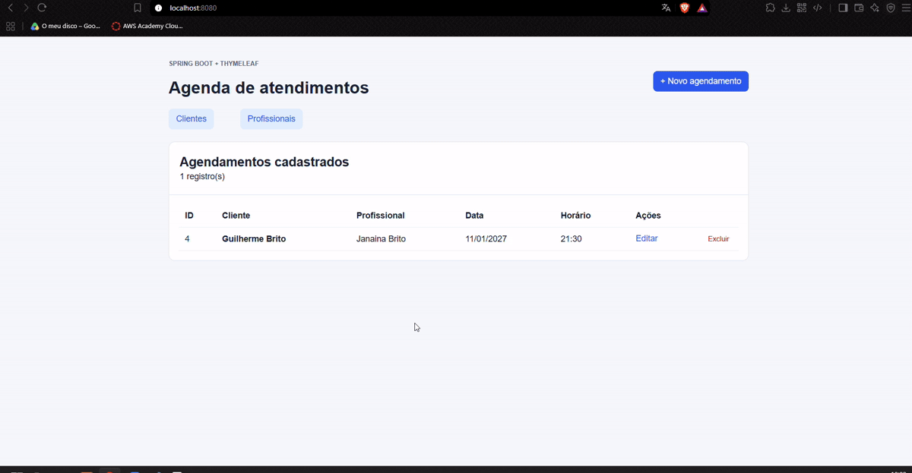

# Agenda com Spring Boot

Aplicação local de agenda desenvolvida com Spring Boot e Thymeleaf para projeto acadêmico.




> CRUD completo de cliente, profissional e agendamento com Spring Boot.

## Tecnologias
Para o desenvolvimento do sistema foram utilizadas as seguintes tecnologias:

<div align="center">
    
</div>

Juntamente de arquitetura MVC e ThymeLeaf.

## Como utilizar o projeto

Pré-requisitos:

- JDK 21 instalado e configurado no `PATH`.
- MySQL instalado e em execução localmente (com XAMPP ou plataforma similar).
- Git, caso ainda precise clonar o repositório.


### 1. Clone o projeto

```bash
git clone https://github.com/pedypowgui/Agenda-spring.git
cd Agenda-spring
```

### 2. Confira o Java

```bash
java -version
```

Se o comando não for reconhecido, instale o JDK 21 e configure `JAVA_HOME` e o `PATH`. Feche e abra novamente o terminal depois de alterar as variáveis.

### 3. Inicie a aplicação

Acesse a pasta raiz do repositório e rode no cmd:

```bash
cd .\backend\api_DS
.\mvnw.cmd spring-boot:run
```

### 4. Acesse a aplicação

No navegador, acesse:
```
http://localhost:8080/
```